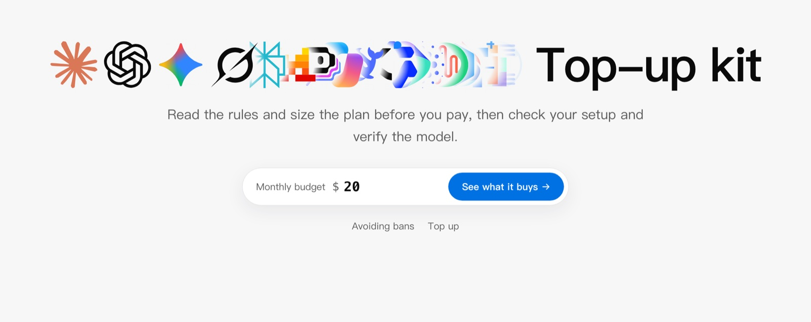
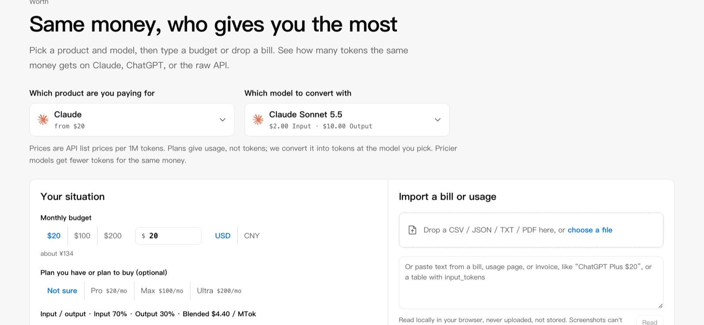
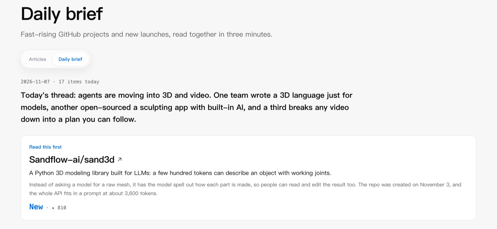
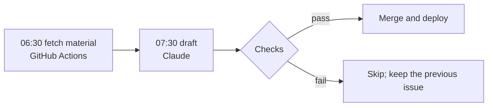

<p align="center">
  <a href="https://app.exploreai.chat"></a>
</p>

<h1 align="center">ExploreAI</h1>

<p align="center"><b>The AI top-up kit: guides → usage → top-up → environment → fingerprint</b></p>
<p align="center">Read the rules and work out your quota before you pay. Check your setup and verify the model after.</p>

<p align="center">
  <a href="https://app.exploreai.chat"></a>
  <a href="https://app.exploreai.chat/claude/brief"></a>
  <a href="https://x.com/_ExploreAI"></a>
  <a href="https://t.me/ExploreAllStudio"></a>
  <a href="README.md"></a>
</p>

<p align="center">
  <a href="https://app.exploreai.chat"></a>
</p>

## Five steps

| Step | Page | What it answers |
| --- | --- | --- |
| Guides | [Guides](https://app.exploreai.chat/claude) | Account safety, top-up and usage guides, covering official rules and appeals only |
| Usage | [Compare](https://app.exploreai.chat/worth) | 117 plans and 49 models: what the same money buys, with optional bill import |
| Top-up | [Shop](https://app.exploreai.chat/shop) | Promoted items, each labelled with its official tier and what you must submit. Not an official channel |
| Environment | [Environment](https://app.exploreai.chat/checkcc) | Checks your IP, timezone, language and connectivity |
| Fingerprint | [Fingerprint](https://app.exploreai.chat/fingerprint) | Shows which model an API most resembles |

There is also a [daily brief](https://app.exploreai.chat/claude/brief): a three-minute pick of AI projects from GitHub and Product Hunt.

<table>
  <tr>
    <td width="50%"></td>
    <td width="50%"></td>
  </tr>
  <tr>
    <td align="center">Plan comparison</td>
    <td align="center">Daily brief</td>
  </tr>
</table>

## Privacy

This is a static site with no backend and no user database. Compare and Fingerprint run entirely in your browser. The environment check contacts third parties for IP and connectivity only after you start it, and that page lists them.

## Where the data comes from

- Plan and API prices come from official pages. `confidence: "live"` means checked against the official page. `"index"` means not yet checked page by page, and the site marks it as pending review.
- Quotas that vendors don't publish are labelled as inferred or unavailable, never presented as exact figures.
- The English site is written ahead of time, so page content never goes to a translation service. `npm run build` fails if Chinese shows up on the English site.

## How the brief ships



Times are Beijing time. The checks verify star counts, that projects exist, hype words, recent repeats and links. The writing rules are in [scripts/BRIEF-RULES.md](scripts/BRIEF-RULES.md).

## Run locally

```bash
npm install
npm run dev
```

Then open <http://localhost:5173/>.

## Contributors

<table>
  <tr>
    <td align="center" width="25%"><a href="https://github.com/EA-Studio-SHARK"><br><b>SHARK</b></a><br><sub>Product, data and operations</sub></td>
    <td align="center" width="25%"><a href="https://github.com/claude"><br><b>Claude</b></a><br><sub>Engineering and the daily brief</sub></td>
  </tr>
</table>

Found a stale price or a wrong source? [Open an issue](https://github.com/EA-Studio-SHARK/planworth/issues) with a link to the official page, or send a PR.

## Acknowledgements

The Environment and Fingerprint pages build on these open-source projects. Their authors have not committed to this repository. The code is used under the MIT license, with notices in [third_party/NOTICE.md](third_party/NOTICE.md).

<table>
  <tr>
    <td align="center" width="25%"><a href="https://github.com/yacuo"><br><b>yacuo</b></a><br><sub><a href="https://github.com/yacuo/check-cc">CheckCC</a><br>Environment check</sub></td>
    <td align="center" width="25%"><a href="https://github.com/Ikaleio"><br><b>Ikaleio</b></a><br><sub><a href="https://github.com/Ikaleio/lm-detector">LM Fingerpoint Detector</a><br>Model fingerprinting</sub></td>
    <td align="center" width="25%"><a href="https://github.com/xqy2006"><br><b>xqy2006</b></a><br><sub><a href="https://github.com/xqy2006/ModelTrace">ModelTrace</a><br>Algorithm idea and some source data</sub></td>
  </tr>
</table>
