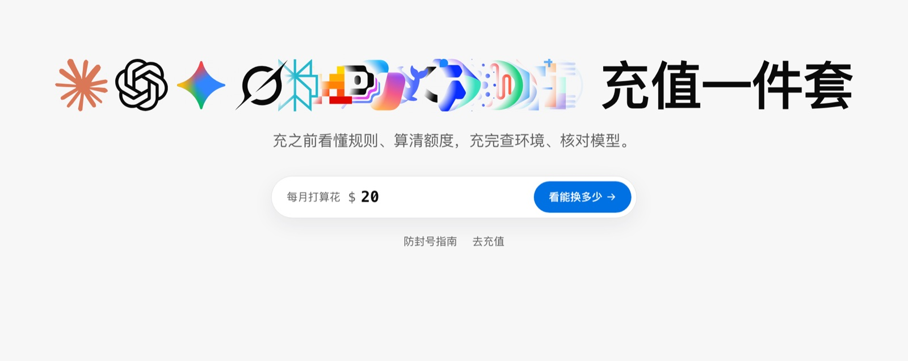
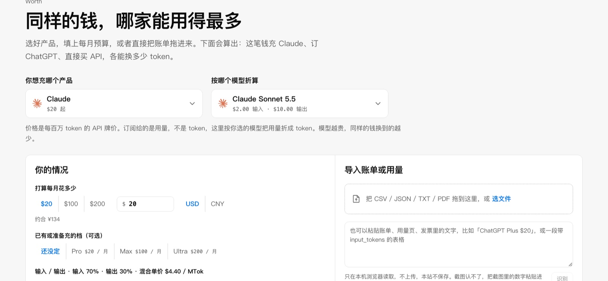
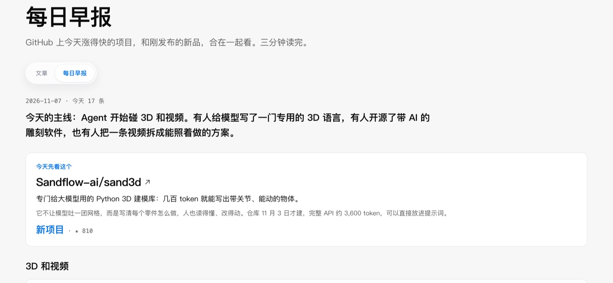
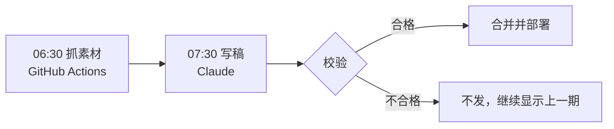

<p align="center">
  <a href="https://app.exploreai.chat"></a>
</p>

<h1 align="center">ExploreAI</h1>

<p align="center"><b>充值一件套：文案 → 使用 → 充值 → 环境 → 指纹</b></p>
<p align="center">充之前看懂规则、算清额度，充完查环境、核对模型。</p>

<p align="center">
  <a href="https://app.exploreai.chat"></a>
  <a href="https://app.exploreai.chat/#/claude/brief"></a>
  <a href="https://x.com/_ExploreAI"></a>
  <a href="https://t.me/ExploreAllStudio"></a>
  <a href="README.en.md"></a>
</p>

<p align="center">
  <a href="https://app.exploreai.chat"></a>
</p>

## 五步

| 步骤 | 页面 | 解决什么 |
| --- | --- | --- |
| 文案 | [专栏](https://app.exploreai.chat/#/claude) | 防封号、充值和使用教程，只讲官方规则和申诉 |
| 使用 | [对照](https://app.exploreai.chat/#/worth) | 117 个套餐、49 个模型，同样的钱能换多少，可以导入自己的账单 |
| 充值 | [商店](https://app.exploreai.chat/#/shop) | 推广商品，逐件标明对应的官方档位和需要提交什么。这不是官方渠道 |
| 环境 | [环境](https://app.exploreai.chat/#/checkcc) | 检查 IP、时区、语言和连通性 |
| 指纹 | [指纹](https://app.exploreai.chat/#/fingerprint) | 判断 API 背后最像哪个模型 |

另外每天有一期[早报](https://app.exploreai.chat/#/claude/brief)，筛选 GitHub 和 Product Hunt 上值得看的 AI 项目，三分钟读完。

<table>
  <tr>
    <td width="50%"></td>
    <td width="50%"></td>
  </tr>
  <tr>
    <td align="center">额度对照</td>
    <td align="center">每日早报</td>
  </tr>
</table>

## 隐私

静态站，没有后端和用户数据库。对照和指纹只在你的浏览器里计算；环境检测开始后才会连第三方查询 IP 和连通性，名单写在环境页上。

## 数据怎么来

- 套餐和 API 价格来自官方页。`confidence: "live"` 表示已对照官方页，`"index"` 表示还没逐页核对，页面显示「待复核」。
- 官方没公开的配额写成「推测」或「未获取」，不用估算数冒充。
- 英文是提前写好的静态内容，不会把页面内容发给翻译服务。`npm run build` 发现英文站有中文就会失败。

## 早报怎么发



校验会核对 star 数、项目是否真实存在、夸张用语、近期重复和链接是否可访问。写作标准在 [scripts/BRIEF-RULES.md](scripts/BRIEF-RULES.md)。

## 本地运行

```bash
npm install
npm run dev
```

然后打开 <http://localhost:5173/>。

## 贡献者

<table>
  <tr>
    <td align="center" width="25%"><a href="https://github.com/EA-Studio-SHARK"><br><b>SHARK</b></a><br><sub>产品、数据与运营</sub></td>
    <td align="center" width="25%"><a href="https://github.com/claude"><br><b>Claude</b></a><br><sub>编程协作与每日早报</sub></td>
  </tr>
</table>

价格过期或来源有错，欢迎[开 Issue](https://github.com/EA-Studio-SHARK/planworth/issues) 并附上官方页链接，也欢迎直接提 PR。

## 致谢

环境和指纹两页建立在下面这些开源项目上。作者没有直接向本仓库提交，代码按 MIT 许可引用，版权和许可说明见 [third_party/NOTICE.md](third_party/NOTICE.md)。

<table>
  <tr>
    <td align="center" width="25%"><a href="https://github.com/yacuo"><br><b>yacuo</b></a><br><sub><a href="https://github.com/yacuo/check-cc">CheckCC</a><br>环境检测</sub></td>
    <td align="center" width="25%"><a href="https://github.com/Ikaleio"><br><b>Ikaleio</b></a><br><sub><a href="https://github.com/Ikaleio/lm-detector">LM Fingerpoint Detector</a><br>模型指纹</sub></td>
    <td align="center" width="25%"><a href="https://github.com/xqy2006"><br><b>xqy2006</b></a><br><sub><a href="https://github.com/xqy2006/ModelTrace">ModelTrace</a><br>算法思路和部分原始数据</sub></td>
  </tr>
</table>
